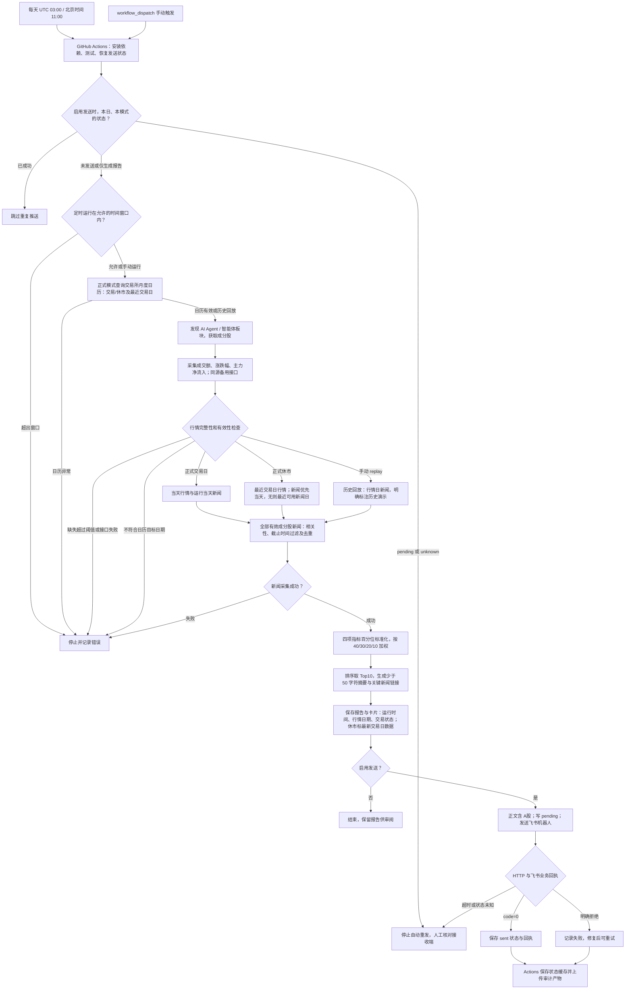

# 业务流程图

GitHub 支持直接渲染以下 Mermaid。独立图片见 [workflow.svg](docs/workflow.svg)。

- 定时固定使用 `live`、开启发送；北京时间 11:00–11:20 之外启动会停止。
- 手动支持 `live`、`replay`、`demo`。上图展示真实数据路径；`demo` 是离线模拟，不能作为真实采集证明。
- `replay` 使用接口最新交易日行情，消息标注“历史数据演示”，不能称为执行日 11:00 快照。
- 正式休市逐股优先运行当天新闻，无则选最近可用新闻日，标注实际发布日期；无可用新闻时说明，不编造链接。
- 日历按月动态获取，不硬编码某个交易日；开市后自动要求当天行情。日历或接口失败会终止评分。
- `--from-report` 可从已保存快照恢复，发送前重新校验评分与新闻。
- Actions 缓存用于尽力去重；送达不明时需人工确认，避免自动重复发送。
